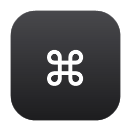
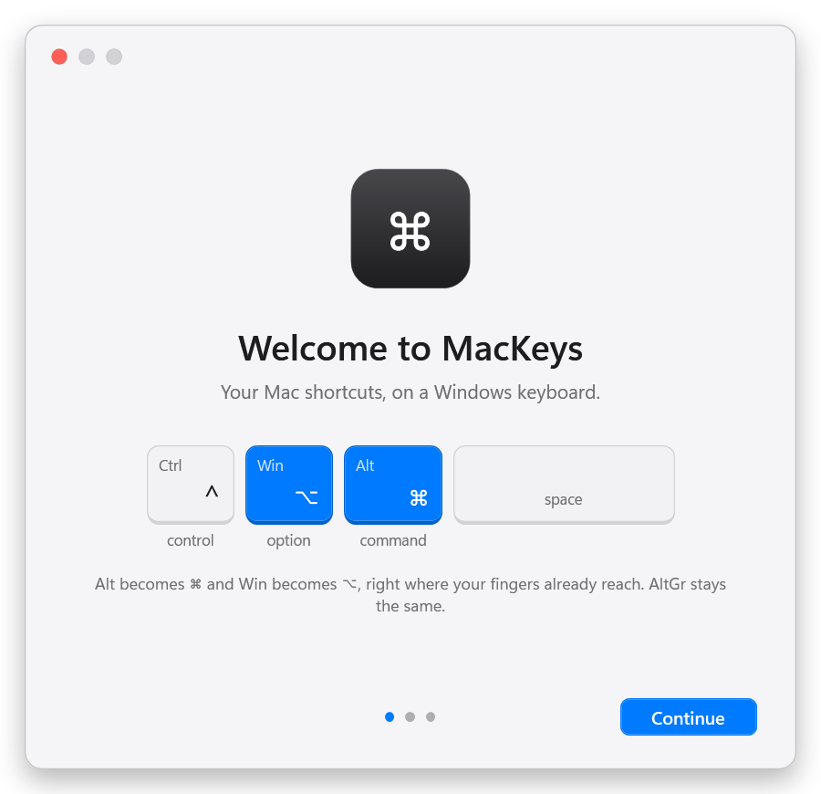
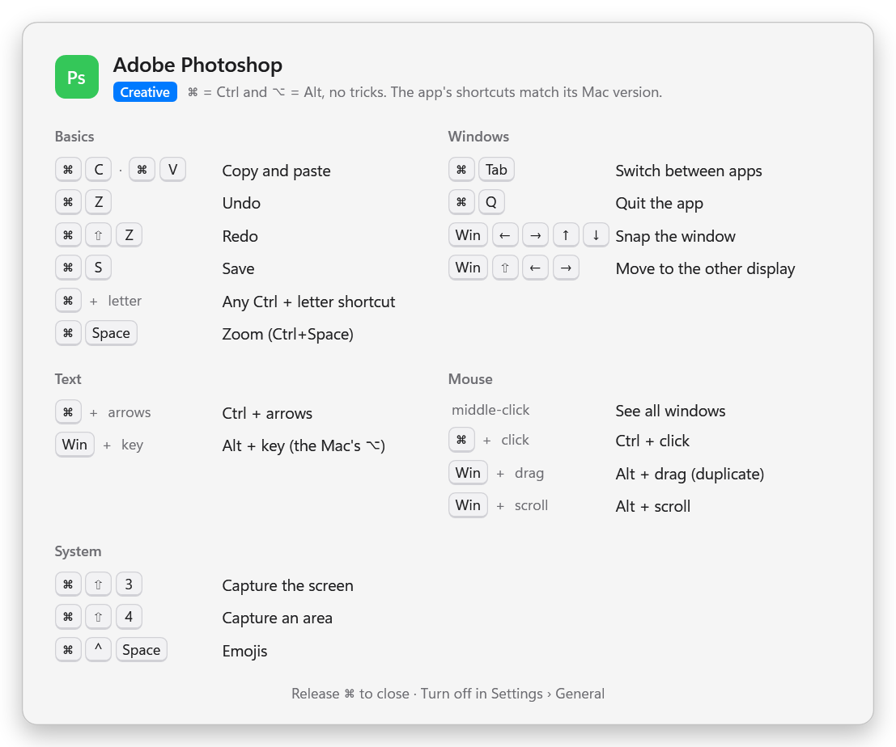
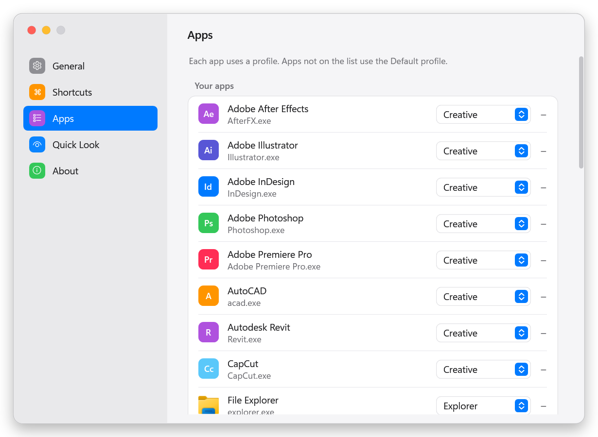
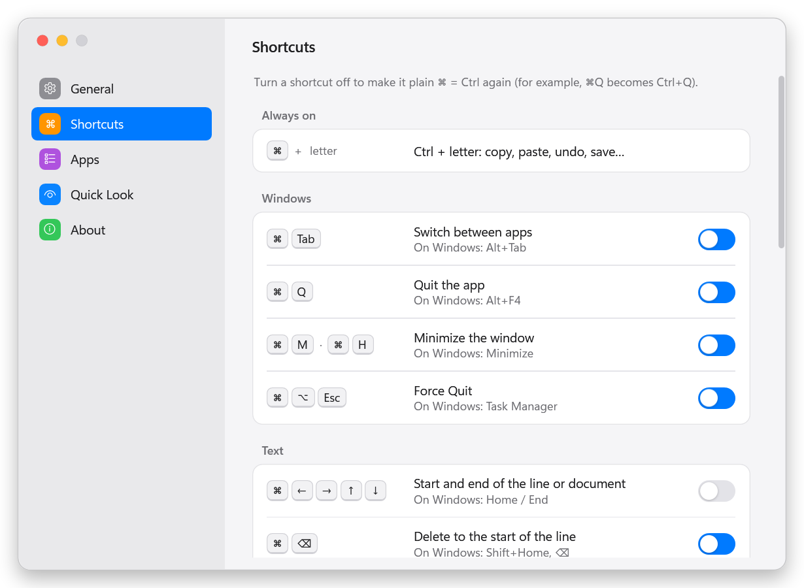
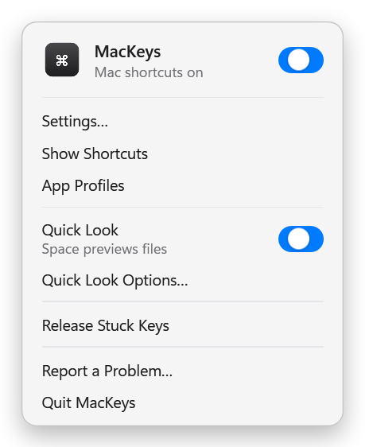
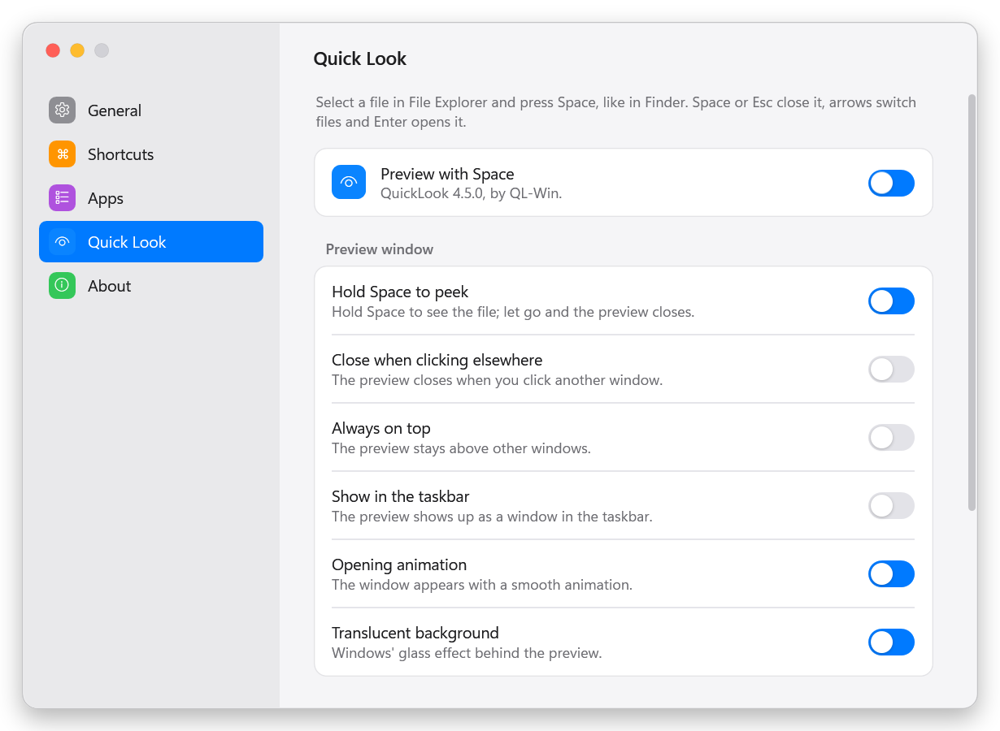
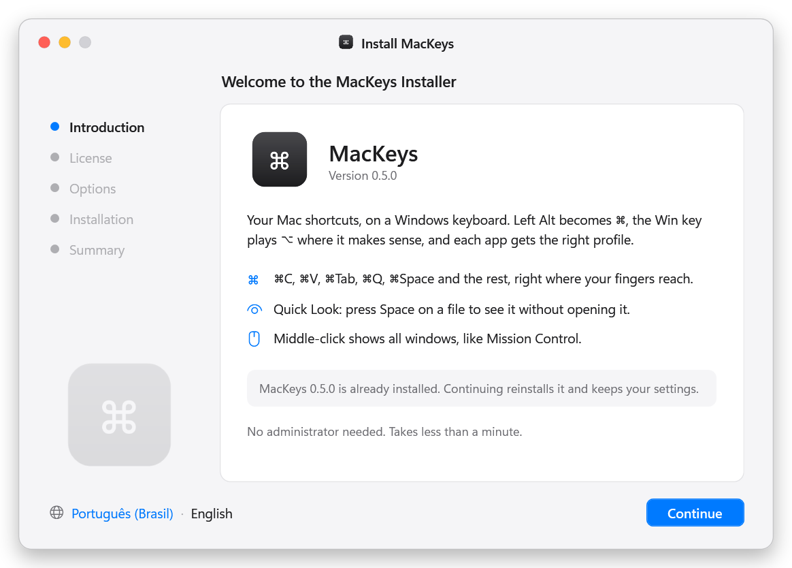
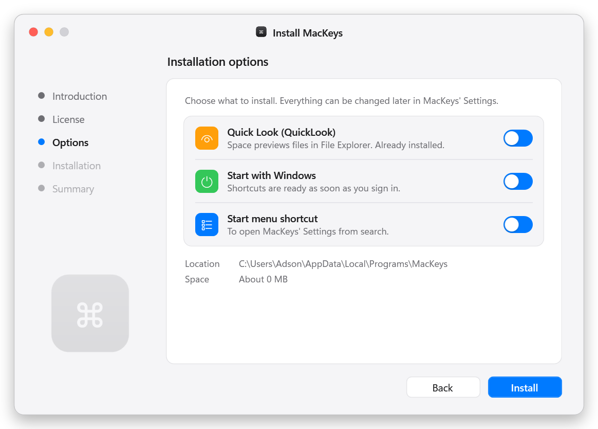
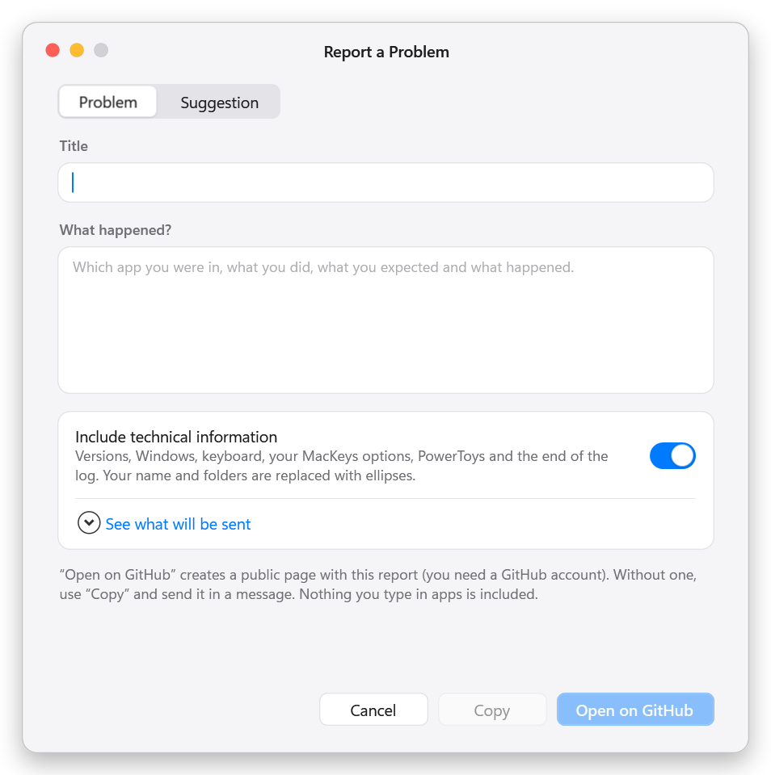

<div align="center">

<b>English</b> · <a href="README.pt-BR.md">Português (Brasil)</a>



# MacKeys

<h3>
  
  <i>Your Mac shortcuts, on a Windows keyboard</i>
  
</h3>

**For people who came from the Mac and don't want to unlearn.**

<p>
  <a href="https://github.com/adson-souza/MacKeys/releases">
    
  </a>
  
  
  
  
  <a href="https://github.com/QL-Win/QuickLook">
    
  </a>
</p>

<br>

<picture>
  <source media="(prefers-color-scheme: dark)" srcset="docs/images/en/boas-vindas-1-escuro.png">
  
</picture>

<br><br>

<table>
  <tr>
    <td align="center" width="20%">
      <a href="#-the-problem">
        <br>
        <b>The Problem</b>
      </a>
    </td>
    <td align="center" width="20%">
      <a href="#%EF%B8%8F-shortcuts">
        <br>
        <b>Shortcuts</b>
      </a>
    </td>
    <td align="center" width="20%">
      <a href="#-quick-look">
        <br>
        <b>Quick Look</b>
      </a>
    </td>
    <td align="center" width="20%">
      <a href="#-install">
        <br>
        <b>Install</b>
      </a>
    </td>
    <td align="center" width="20%">
      <a href="#-credits">
        <br>
        <b>Credits</b>
      </a>
    </td>
  </tr>
</table>

</div>

<br>

---

## 💡 The Problem

<table>
<tr>
<td width="60%">

### Years of Mac in your fingers, a Windows PC on your desk

You switched computers (maybe your work runs on Windows-only apps), but your fingers still reach for ⌘ next to the space bar. On Windows that's **Alt**: ⌘C opens a menu, ⌘Q closes nothing and ⌘Tab does something else.

MacKeys fixes it at the right key: **left Alt becomes ⌘**, the **Win key plays ⌥ Option** where it makes sense, and each app gets the right profile (Photoshop, Revit, Excel, File Explorer…).

Right Alt doesn't change, so **AltGr keeps working** for accents and symbols.

</td>
<td width="40%">

```
 WITHOUT MacKeys
┌──────────────────────┐
│ ⌘C → Alt menu        │
│ ⌘Q → nothing         │
│ ⌘Tab → ???           │
└──────────────────────┘

 WITH MacKeys
┌──────────────────────┐
│ ⌘C → copy  ✓         │
│ ⌘Q → quit app ✓      │
│ ⌘Tab → switch app ✓  │
└──────────────────────┘
```

</td>
</tr>
</table>

<br>

---

## ⌨️ Shortcuts

| Mac | Becomes on Windows |
|---|---|
| ⌘ + any key (C, V, X, Z, S, T, W, F, A…) | Ctrl + key |
| ⌘Tab / ⌘⇧Tab | Alt+Tab (hold ⌘ to keep choosing) |
| ⌘Q | Alt+F4 |
| ⌘M / ⌘H | Minimize window |
| ⌘Space | PowerToys Command Palette (or Windows Search) |
| ⌘⌃Space | Emoji panel |
| ⌘⇧3 | Print Screen |
| ⌘⇧4 / ⌘⇧5 | Snipping Tool (Win+Shift+S) |
| ⌘⌥Esc | Task Manager |
| Win + arrows | Stay Windows' own (snap windows, move between displays) |

Off by default, but available in Settings › Shortcuts: ⌘+arrows (start and end of the line or document) and ⌥+arrows (jump words).

**Hold ⌘ for a second** to see the shortcut cheat sheet for the current app:

<div align="center">
<picture>
  <source media="(prefers-color-scheme: dark)" srcset="docs/images/en/cola-criativo-escuro.png">
  
</picture>
</div>

### 🖱️ Mouse

| Mac | Becomes on Windows |
|---|---|
| ⌘ + click / drag / scroll | Ctrl + click / drag / scroll |
| Win (⌥) + click / drag / scroll | Alt + click / drag / scroll |
| Quick middle-click | See all windows (Task View, like Mission Control) |

Examples: ⌘+click opens a link in a new tab, Win+drag duplicates objects in Illustrator and Win+scroll zooms in Photoshop.

Dragging with the middle button works as usual in every app (panning in Figma, autoscroll in the browser). In Revit and AutoCAD the middle button doesn't change at all, and you can add more apps in Settings › Apps › "Regular middle button in these apps".

### 🎨 Per-app profiles

| Profile | Apps | What changes |
|---|---|---|
| **Default** | Everything else (Notion, WhatsApp, browser…) | The shortcuts above |
| **Explorer** | File Explorer | Finder shortcuts: ⌘P preview pane, ⌘↑ enclosing folder, ⌘↓ open, ⌘[ ⌘] back/forward, ⌘⌫ Recycle Bin, ⌘I properties, ⌘1–4 view modes |
| **Document** | Word, PowerPoint | ⌘↑/↓ jump paragraphs |
| **Spreadsheet** | Excel | ⌘+arrows go to the edge of the data |
| **Creative** | Photoshop, Illustrator, InDesign, Premiere, After Effects, Revit, AutoCAD, CapCut | ⌘ = Ctrl and Win+key = Alt+key (the ⌥ of Mac shortcuts, including ⌘⌥). ⌘Space becomes Ctrl+Space (zoom) |
| **Off** | Remote Desktop, virtual machines | MacKeys leaves the keyboard alone |

<table>
<tr>
<td width="50%">
<picture>
  <source media="(prefers-color-scheme: dark)" srcset="docs/images/en/config-Apps-escuro.png">
  
</picture>
</td>
<td width="50%">
<picture>
  <source media="(prefers-color-scheme: dark)" srcset="docs/images/en/config-Shortcuts-escuro.png">
  
</picture>
</td>
</tr>
</table>

The ⌘ next to the clock is **blue** while MacKeys is on and **gray** when paused. Click it for the menu:

<div align="center">
<picture>
  <source media="(prefers-color-scheme: dark)" srcset="docs/images/en/menu-escuro.png">
  
</picture>
</div>

<br>

---

## 🔍 Quick Look

Select a file in File Explorer and press **Space**, just like in Finder. **Space** or **Esc** close it, the **arrows** switch files and **Enter** opens it.

MacKeys' Quick Look is **[QuickLook](https://github.com/QL-Win/QuickLook)**, the most complete open-source previewer for Windows: images (including PSD and HEIC), PDF, Office, video, audio, code, fonts, 3D models, archives and much more, with plugins.

- The MacKeys installer downloads the **official portable version** straight from QuickLook's GitHub releases, checks the published **SHA-256** and installs it **unmodified** in `%LOCALAPPDATA%\Programs\MacKeys\QuickLook`.
- MacKeys opens and closes QuickLook along with itself and hides its tray icon: the ⌘ is enough.
- All of QuickLook's options (hold Space to peek, close when clicking elsewhere, always on top, translucent background, plugins…) live in **Settings › Quick Look**, and the ⌘ menu turns Quick Look on and off.

<div align="center">
<picture>
  <source media="(prefers-color-scheme: dark)" srcset="docs/images/en/config-QuickLook-escuro.png">
  
</picture>
</div>

> [!NOTE]
> If **PowerToys Peek** is on, the installer asks which of the two you want, so they don't fight over the Space key.

<br>

---

## 📦 Install

Download **`MacKeys-0.5.0-Instalador.exe`** from [Releases](https://github.com/adson-souza/MacKeys/releases) and open it. No administrator and no .NET needed.

<table>
<tr>
<td width="50%">
<picture>
  <source media="(prefers-color-scheme: dark)" srcset="docs/images/en/instalador-introducao-escuro.png">
  
</picture>
</td>
<td width="50%">
<picture>
  <source media="(prefers-color-scheme: dark)" srcset="docs/images/en/instalador-opcoes-escuro.png">
  
</picture>
</td>
</tr>
</table>

The installer:

1. Installs MacKeys for your user in `%LOCALAPPDATA%\Programs\MacKeys`, with a Start menu shortcut and an entry in **Settings › Apps › Installed apps**.
2. Downloads QuickLook (about 63 MB), if you want it.
3. Checks **PowerToys**: lists active Keyboard Manager remappings (the same key converted twice causes conflicts) and offers to remove them, and settles the Peek vs. Quick Look conflict. Before changing anything it closes PowerToys, keeps a backup of every file it touches (`*.mackeys-backup-<date>`) and reopens PowerToys afterwards.
4. Updates an earlier version, keeping your settings.

**Language:** MacKeys and its installer speak Brazilian Portuguese when Windows is in Portuguese, and English otherwise. To switch, use the picker on the installer's first screen or Settings › General › Language.

> [!TIP]
> If Windows shows "Windows protected your PC", click **More info** and then **Run anyway**.

**Updating:** once a day MacKeys checks GitHub releases for new versions of itself and of QuickLook. When one shows up, the ⌘ lets you know and the menu gets "Update to version…". One click downloads the installer, checks the SHA-256 published by GitHub and swaps the version, keeping your settings. QuickLook updates on its own, in the Quick Look tab. Nothing installs without you asking.

**Testing:** Settings › About › **Test the keyboard…** runs a 15-second self-test and opens a report where every line should say OK.

**Uninstalling:** Windows Settings › Apps › Installed apps › MacKeys › Uninstall. You choose whether to keep your settings.

**Moving your settings:** Settings › About › "Settings file". Copy `settings.json` to `%APPDATA%\MacKeys\` on the new computer, with MacKeys closed.

<br>

---

## 🐞 Found a problem?

Click the ⌘ next to the clock › **Report a Problem…**. You describe what happened and MacKeys gathers the technical details: versions, Windows, keyboard, your options, PowerToys and the end of the log. You see the whole text before sending it. **Open on GitHub** creates a prefilled issue, and **Copy** lets you send it in a message.

<div align="center">
<picture>
  <source media="(prefers-color-scheme: dark)" srcset="docs/images/en/relatar-escuro.png">
  
</picture>
</div>

- **No hidden collection:** nothing is sent on its own and there's no server. The log never records what you type, only events like "keyboard ready".
- **Personal data replaced:** your user name, computer name and folders become ellipses before you even see the report.
- **Unexpected errors** are kept in `%APPDATA%\MacKeys\erros`, and MacKeys offers to report them the next time it opens.

On the web, use [New issue](https://github.com/adson-souza/MacKeys/issues/new/choose) › Problem or Suggestion.

<br>

---

## 🛠️ Development

Requires the **.NET 8 SDK** on Windows 10/11.

```
dotnet build MacKeys
```

| Script | What for |
|---|---|
| `make-package.ps1` | Builds `dist\MacKeys-<version>-Instalador.exe`: a single, self-contained, ahead-of-time compiled (ReadyToRun) executable |
| `tools/make-icon.ps1` | Regenerates the icon |

The installer **is MacKeys itself**: with "Instalador" or "Setup" in the file name (or with `--install`) it opens the installer window; installed in `%LOCALAPPDATA%\Programs\MacKeys`, it runs as the app.

| Command | What it does |
|---|---|
| `MacKeys.exe --install [--silent]` | Installer (`--silent`: no window, keeps the current choices and leaves PowerToys alone) |
| `MacKeys.exe --uninstall [--silent]` | Uninstaller (`--silent`: no window, keeps the settings) |
| `MacKeys.exe --install-quicklook` | Downloads and installs QuickLook, no window |
| `MacKeys.exe --selftest report.txt` | Keyboard and mouse self-test in its own window. Settings stay in memory |
| `MacKeys.exe --screenshots folder [pt\|en]` | Renders every screen, light and dark, in the chosen language (the README images come from here). In English it lists untranslated texts in `faltando.txt` |

Settings in `%APPDATA%\MacKeys\settings.json`, log in `%APPDATA%\MacKeys\debug.log`, installer log in `%TEMP%\MacKeys-instalacao.log`.

### Keyboard architecture (read before changing it)

- The keyboard and mouse hooks run on a **dedicated high-priority thread** (`HookHost`). On the UI thread, any busy moment made Windows deliver keys without going through MacKeys, and one lost ⌘ release left the virtual Ctrl stuck.
- Before the hook is installed, the whole keyboard path is **precompiled** (`KeyMapper.WarmUp`). If the first key blows Windows' deadline, the hook is removed for good.
- No disk access in the hook: the log is a queue written in the background.
- A **watchdog** gets the physical keyboard via Raw Input from a **helper process** (`--raw-helper`). Raw Input registered in the main process makes Windows stop calling the hook. If the watchdog sees ⌘ released without the hook noticing, it unsticks everything.
- The Win key is **never intercepted**: Windows 11 ignores Win+arrows re-sent after interception.
- Quick Look doesn't go through MacKeys' hook: QuickLook listens for Space on its own.

### Languages

Brazilian Portuguese (PT-BR) is the source language: every text is written in PT-BR and is the key into the English table (`Strings.En.cs`). Windows are translated when they open (`L.Translate`), and texts built in code go through `L.T` and `L.F`. When you change a PT-BR text, update its key in the table; `--screenshots folder en` points out anything left untranslated.

<br>

---

## 🤝 Credits

<table>
<tr>
<td width="80" align="center">
  
</td>
<td>

**MacKeys**: made by **Adson Pereira de Souza**.

</td>
</tr>
<tr>
<td width="80" align="center">
  <a href="https://github.com/QL-Win/QuickLook"></a>
</td>
<td>

**[QuickLook](https://github.com/QL-Win/QuickLook)**: MacKeys' Quick Look. Created by [Paddy Xu](https://github.com/xupefei) and maintained by the [QL-Win contributors](https://github.com/QL-Win/QuickLook/graphs/contributors). Free software under the [GPL-3.0](https://github.com/QL-Win/QuickLook/blob/master/LICENSE). MacKeys downloads the official version unmodified and includes none of QuickLook's code. Details in [THIRD-PARTY-NOTICES.md](THIRD-PARTY-NOTICES.md).

</td>
</tr>
</table>

Animated icons in this README: [Animated Fluent Emojis](https://github.com/Tarikul-Islam-Anik/Animated-Fluent-Emojis), based on Microsoft's [Fluent Emoji](https://github.com/microsoft/fluentui-emoji).

<div align="center">
<br>
<sub>Made for people who don't want to unlearn ⌘</sub>
</div>
