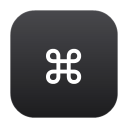
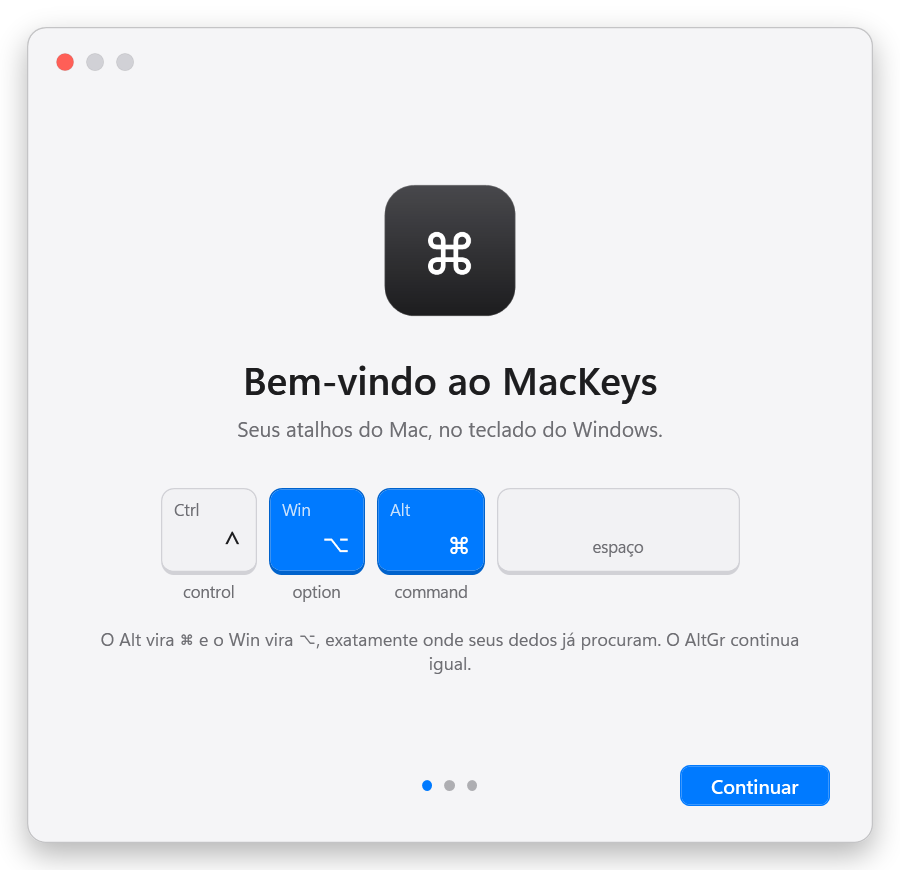
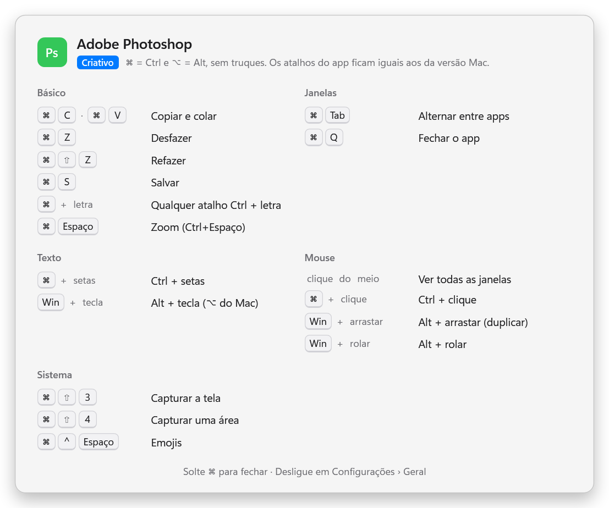
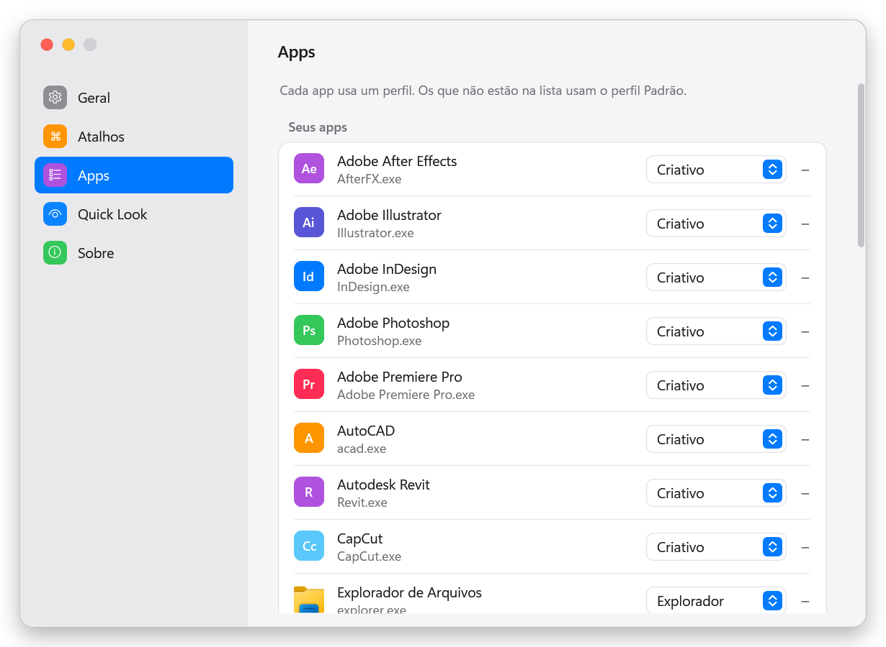
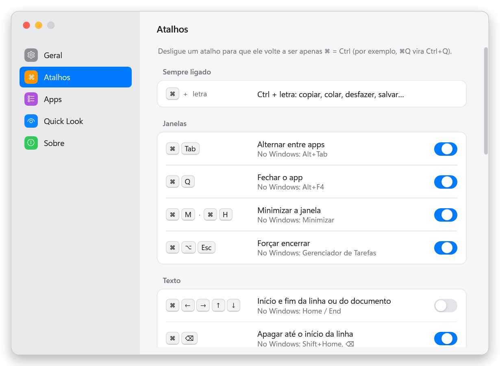
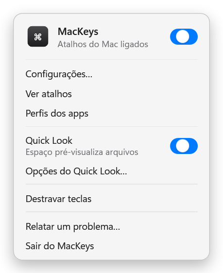
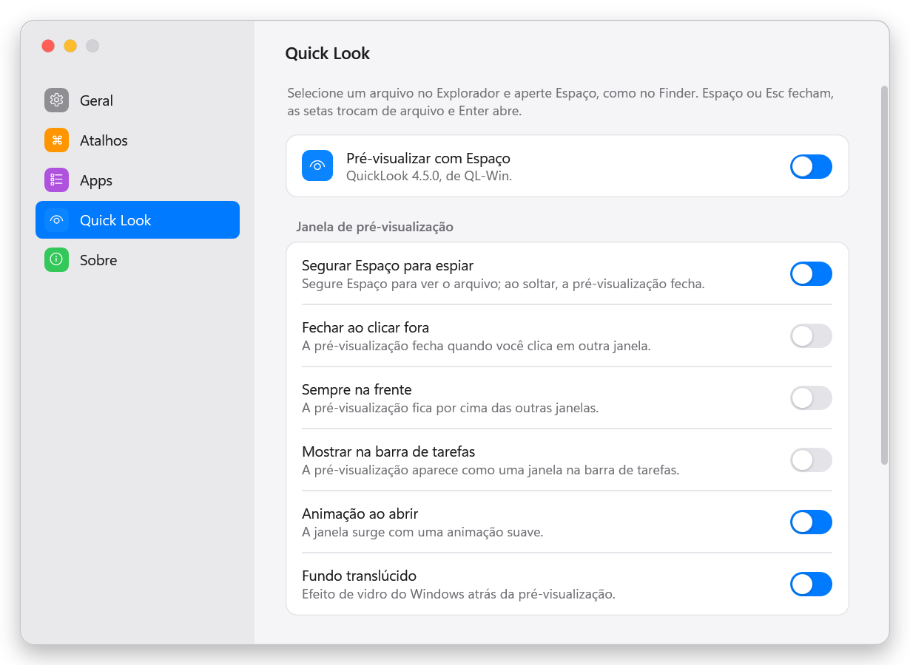
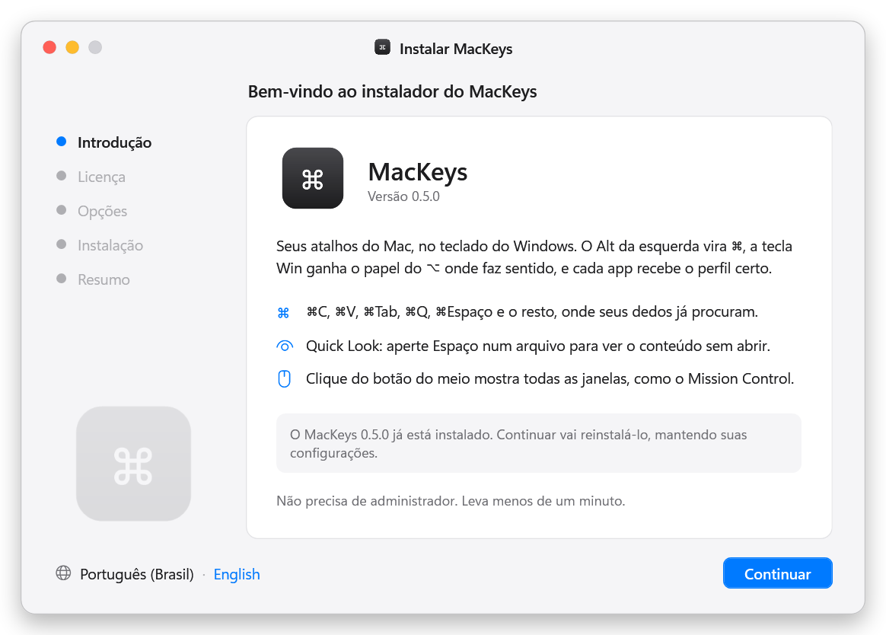
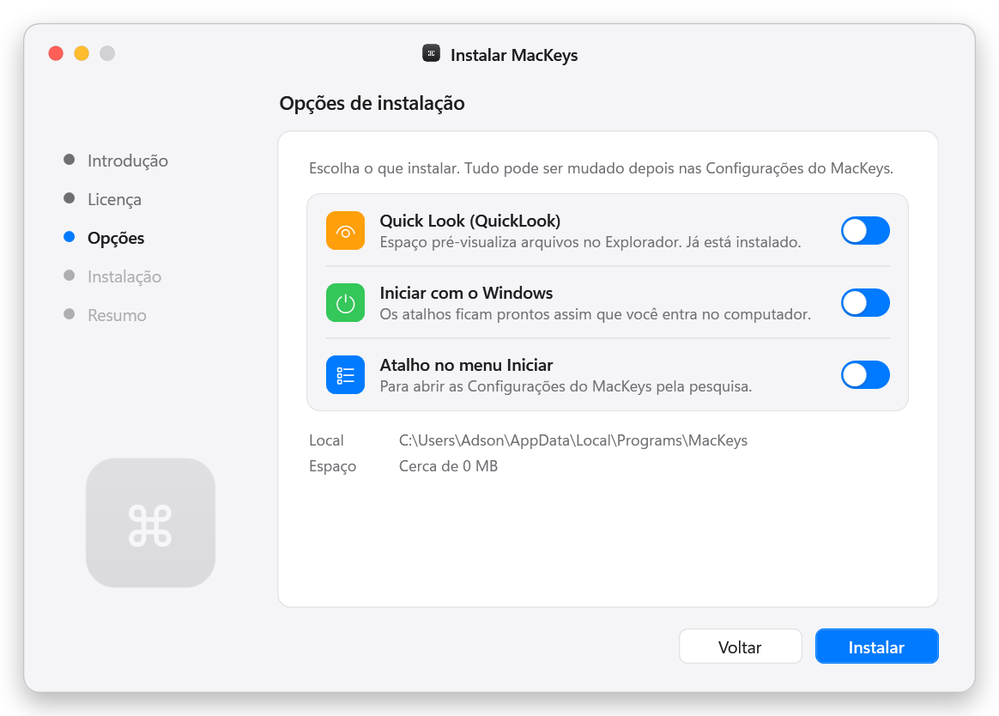
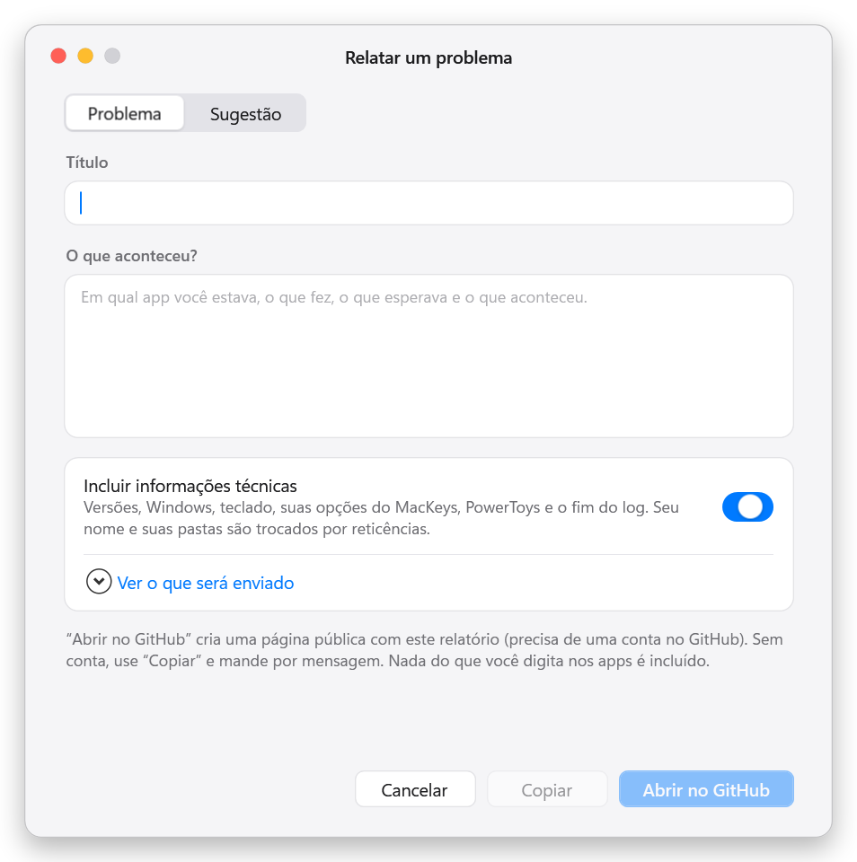

<div align="center">

<a href="README.md">English</a> · <b>Português (Brasil)</b>



# MacKeys

<h3>
  
  <i>Seus atalhos do Mac, no teclado do Windows</i>
  
</h3>

**Para quem veio do Mac e não quer desaprender.**

<p>
  <a href="https://github.com/adson-souza/MacKeys/releases">
    
  </a>
  
  
  
  
  <a href="https://github.com/QL-Win/QuickLook">
    
  </a>
</p>

<br>

<picture>
  <source media="(prefers-color-scheme: dark)" srcset="docs/images/pt/boas-vindas-1-escuro.png">
  
</picture>

<br><br>

<table>
  <tr>
    <td align="center" width="20%">
      <a href="#-o-problema">
        <br>
        <b>O problema</b>
      </a>
    </td>
    <td align="center" width="20%">
      <a href="#%EF%B8%8F-atalhos">
        <br>
        <b>Atalhos</b>
      </a>
    </td>
    <td align="center" width="20%">
      <a href="#-quick-look">
        <br>
        <b>Quick Look</b>
      </a>
    </td>
    <td align="center" width="20%">
      <a href="#-instalar">
        <br>
        <b>Instalar</b>
      </a>
    </td>
    <td align="center" width="20%">
      <a href="#-créditos">
        <br>
        <b>Créditos</b>
      </a>
    </td>
  </tr>
</table>

</div>

<br>

---

## 💡 O problema

<table>
<tr>
<td width="60%">

### Anos de Mac nos dedos, um Windows na mesa

Você trocou de computador (o Revit não roda no Mac), mas os dedos continuam procurando o ⌘ do lado do espaço. No Windows, ali fica o **Alt**: ⌘C abre um menu, ⌘Q não fecha nada e ⌘Tab vira outra coisa.

O MacKeys resolve isso na tecla certa: **o Alt da esquerda vira ⌘**, a tecla **Win ganha o papel do ⌥ Option** onde faz sentido, e cada app recebe o perfil adequado (Photoshop, Revit, Excel, Explorador…).

O Alt da direita não muda, então o **AltGr continua funcionando no ABNT2**.

</td>
<td width="40%">

```
 SEM o MacKeys
┌──────────────────────┐
│ ⌘C → menu do Alt     │
│ ⌘Q → nada            │
│ ⌘Tab → ???           │
└──────────────────────┘

 COM o MacKeys
┌──────────────────────┐
│ ⌘C → copiar  ✓       │
│ ⌘Q → fechar o app ✓  │
│ ⌘Tab → trocar app ✓  │
└──────────────────────┘
```

</td>
</tr>
</table>

<br>

---

## ⌨️ Atalhos

| Mac | Vira no Windows |
|---|---|
| ⌘ + qualquer tecla (C, V, X, Z, S, T, W, F, A…) | Ctrl + tecla |
| ⌘Tab / ⌘⇧Tab | Alt+Tab (segure ⌘ para continuar escolhendo) |
| ⌘Q | Alt+F4 |
| ⌘M / ⌘H | Minimizar janela |
| ⌘Espaço | Paleta de Comandos do PowerToys (ou pesquisa do Windows) |
| ⌘⌃Espaço | Painel de emojis |
| ⌘⇧3 | Print Screen |
| ⌘⇧4 / ⌘⇧5 | Ferramenta de Captura (Win+Shift+S) |
| ⌘⌥Esc | Gerenciador de Tarefas |
| Win + setas | Continuam do Windows (encaixar janelas, mover entre monitores), exceto nos apps do perfil Criativo |

Desligados por padrão, mas disponíveis em Configurações › Atalhos: ⌘+setas (início e fim da linha ou do documento) e ⌥+setas (pular palavras).

**Segure ⌘ por um segundo** e aparece a cola de atalhos do app aberto:

<div align="center">
<picture>
  <source media="(prefers-color-scheme: dark)" srcset="docs/images/pt/cola-criativo-escuro.png">
  
</picture>
</div>

### 🖱️ Mouse

| Mac | Vira no Windows |
|---|---|
| ⌘ + clique / arrastar / rolar | Ctrl + clique / arrastar / rolar |
| Win (⌥) + clique / arrastar / rolar | Alt + clique / arrastar / rolar |
| Clique rápido do botão do meio | Ver todas as janelas (Visão de Tarefas, como o Mission Control) |

Exemplos: ⌘+clique abre um link em nova aba, Win+arrastar duplica objetos no Illustrator e Win+rolar dá zoom no Photoshop.

Arrastar com o botão do meio continua normal em todos os apps (mover a tela no Figma, rolagem automática no navegador). No Revit e no AutoCAD o botão do meio não muda nada, e dá para adicionar outros apps em Configurações › Apps › "Botão do meio normal nestes apps".

### 🎨 Perfis por app

| Perfil | Apps | O que muda |
|---|---|---|
| **Padrão** | Todos os outros (Notion, WhatsApp, navegador…) | Atalhos acima |
| **Explorador** | Explorador de Arquivos | Atalhos do Finder: ⌘P painel de visualização, ⌘↑ pasta acima, ⌘↓ abrir, ⌘[ ⌘] voltar/avançar, ⌘⌫ Lixeira, ⌘I propriedades, ⌘1–4 modos de exibição |
| **Documento** | Word, PowerPoint | ⌘↑/↓ pula parágrafo |
| **Planilha** | Excel | ⌘+setas vão até a borda dos dados |
| **Criativo** | Photoshop, Illustrator, InDesign, Premiere, After Effects, Revit, AutoCAD, CapCut | ⌘ = Ctrl e Win = Alt assim que é apertado, como um remapeamento do PowerToys: Alt+arrastar duplica, Alt ao redimensionar mantém o centro, ⌘⌥ funciona. ⌘Espaço vira Ctrl+Espaço (zoom) |
| **Desativado** | Área de Trabalho Remota, máquinas virtuais | O MacKeys não mexe no teclado |

<table>
<tr>
<td width="50%">
<picture>
  <source media="(prefers-color-scheme: dark)" srcset="docs/images/pt/config-Apps-escuro.png">
  
</picture>
</td>
<td width="50%">
<picture>
  <source media="(prefers-color-scheme: dark)" srcset="docs/images/pt/config-Shortcuts-escuro.png">
  
</picture>
</td>
</tr>
</table>

O ⌘ perto do relógio fica **azul** com o MacKeys ativo e **cinza** quando pausado. Um clique abre o menu:

<div align="center">
<picture>
  <source media="(prefers-color-scheme: dark)" srcset="docs/images/pt/menu-escuro.png">
  
</picture>
</div>

<br>

---

## 🔍 Quick Look

Selecione um arquivo no Explorador e aperte **Espaço**, como no Finder. **Espaço** ou **Esc** fecham, as **setas** trocam de arquivo e **Enter** abre.

O Quick Look do MacKeys é o **[QuickLook](https://github.com/QL-Win/QuickLook)**, o projeto de código aberto mais completo de pré-visualização para Windows: imagens (incluindo PSD e HEIC), PDF, Office, vídeo, áudio, código, fontes, modelos 3D, arquivos compactados e muito mais, com plugins.

- O instalador do MacKeys baixa a **versão portátil oficial** direto dos lançamentos do QuickLook no GitHub, confere a **assinatura SHA-256** publicada e a instala **sem modificações** em `%LOCALAPPDATA%\Programs\MacKeys\QuickLook`.
- O MacKeys abre e fecha o QuickLook junto com ele e esconde o ícone dele na bandeja: o ⌘ basta.
- Todas as opções do QuickLook (segurar Espaço para espiar, fechar ao clicar fora, sempre na frente, fundo translúcido, plugins…) ficam em **Configurações › Quick Look**, e o menu do ⌘ na bandeja liga e desliga o Quick Look.

<div align="center">
<picture>
  <source media="(prefers-color-scheme: dark)" srcset="docs/images/pt/config-QuickLook-escuro.png">
  
</picture>
</div>

> [!NOTE]
> Se o **Peek do PowerToys** estiver ligado, o instalador pergunta qual dos dois você quer usar, para não disputarem a tecla Espaço.

<br>

---

## 📦 Instalar

Baixe o **`MacKeys-…-Instalador.exe`** da [versão mais recente](https://github.com/adson-souza/MacKeys/releases/latest) e abra. Não precisa de administrador nem de .NET.

<table>
<tr>
<td width="50%">
<picture>
  <source media="(prefers-color-scheme: dark)" srcset="docs/images/pt/instalador-introducao-escuro.png">
  
</picture>
</td>
<td width="50%">
<picture>
  <source media="(prefers-color-scheme: dark)" srcset="docs/images/pt/instalador-opcoes-escuro.png">
  
</picture>
</td>
</tr>
</table>

O instalador:

1. Instala o MacKeys para o seu usuário em `%LOCALAPPDATA%\Programs\MacKeys`, com atalho no menu Iniciar e entrada em **Configurações › Aplicativos › Aplicativos instalados**.
2. Baixa o QuickLook (cerca de 63 MB), se você quiser.
3. Verifica o **PowerToys**: lista os mapeamentos ativos do Keyboard Manager (a mesma tecla convertida duas vezes gera conflito) e oferece removê-los, e resolve o conflito entre Peek e Quick Look. Antes de mudar qualquer coisa, ele fecha o PowerToys, guarda uma cópia de segurança de cada arquivo (`*.mackeys-backup-<data>`) e depois reabre o PowerToys.
4. Atualiza uma versão anterior mantendo suas configurações.

**Idioma:** o MacKeys e o instalador falam português do Brasil quando o Windows está em português, e inglês nos outros casos. Para trocar, use o seletor na primeira tela do instalador ou Configurações › Geral › Idioma.

> [!TIP]
> Se o Windows mostrar "O Windows protegeu o computador", clique em **Mais informações** e depois em **Executar assim mesmo**.

**Atualizar:** o MacKeys procura versões novas dele e do QuickLook uma vez por dia, direto nos lançamentos do GitHub. Quando aparece uma, o ⌘ avisa e o menu ganha "Atualizar para a versão…". Um clique baixa o instalador, confere o SHA-256 publicado pelo GitHub e troca a versão mantendo suas configurações. O QuickLook se atualiza sozinho, na aba Quick Look. Nada é instalado sem você pedir.

**Testar:** Configurações › Sobre › **Testar o teclado…** roda um autoteste de uns 15 segundos e abre um relatório em que todas as linhas devem dizer OK.

**Desinstalar:** em Configurações do Windows › Aplicativos › Aplicativos instalados › MacKeys › Desinstalar. Dá para escolher se as configurações ficam guardadas.

**Levar suas configurações:** Configurações › Sobre › "Mostrar arquivo de configurações". Copie o `settings.json` para `%APPDATA%\MacKeys\` na máquina nova, com o MacKeys fechado.

<br>

---

## 🐞 Encontrou um problema?

Clique no ⌘ perto do relógio › **Relatar um problema…**. Você descreve o que aconteceu e o MacKeys junta as informações técnicas: versões, Windows, teclado, suas opções, PowerToys e o fim do log. Você vê o texto inteiro antes de enviar. **Abrir no GitHub** cria a issue já preenchida, e **Copiar** serve para mandar por mensagem.

<div align="center">
<picture>
  <source media="(prefers-color-scheme: dark)" srcset="docs/images/pt/relatar-escuro.png">
  
</picture>
</div>

- **Sem coleta escondida:** nada é enviado sozinho e não há servidor. O log não grava o que você digita, só eventos como "teclado pronto".
- **Dados pessoais trocados:** seu nome de usuário, o nome do computador e suas pastas viram reticências antes de você ver o relatório.
- **Erros inesperados** ficam guardados em `%APPDATA%\MacKeys\erros`, e o MacKeys oferece relatar na próxima vez que abrir.

Pelo site, use [Nova issue](https://github.com/adson-souza/MacKeys/issues/new/choose) › Problema ou Sugestão.

<br>

---

## 🛠️ Desenvolvimento

Requer o **.NET 8 SDK** no Windows 10/11.

```
dotnet build MacKeys
```

| Script | Para quê |
|---|---|
| `make-package.ps1` | Gera `dist\MacKeys-<versão>-Instalador.exe`: executável único, autossuficiente e compilado antecipadamente (ReadyToRun) |
| `tools/make-icon.ps1` | Regenera o ícone |

O instalador **é o próprio MacKeys**: com "Instalador" ou "Setup" no nome do arquivo (ou com `--install`), ele abre a janela de instalação; instalado em `%LOCALAPPDATA%\Programs\MacKeys`, ele roda como app.

| Comando | O que faz |
|---|---|
| `MacKeys.exe --install [--silent]` | Instalador (`--silent`: sem janela, mantendo as escolhas atuais e sem mexer no PowerToys) |
| `MacKeys.exe --uninstall [--silent]` | Desinstalador (`--silent`: sem janela, mantendo as configurações) |
| `MacKeys.exe --install-quicklook` | Baixa e instala o QuickLook, sem janela |
| `MacKeys.exe --selftest relatorio.txt` | Autoteste do teclado e do mouse numa janela própria. Configurações só em memória |
| `MacKeys.exe --screenshots pasta [pt\|en]` | Gera imagens de todas as telas, claro e escuro, no idioma escolhido (as do README saem daqui). Em inglês, lista em `faltando.txt` os textos sem tradução |

Configurações em `%APPDATA%\MacKeys\settings.json`, log em `%APPDATA%\MacKeys\debug.log`, registro da instalação em `%TEMP%\MacKeys-instalacao.log`.

### Arquitetura do teclado (leia antes de mexer)

- Os ganchos de teclado e mouse rodam numa **linha de execução dedicada**, de prioridade alta (`HookHost`). Na linha da interface, qualquer momento ocupado fazia o Windows entregar teclas sem passar pelo MacKeys, e uma soltura do ⌘ perdida deixava o Ctrl virtual preso.
- Antes de instalar o gancho, todo o caminho do teclado é **pré-compilado** (`KeyMapper.WarmUp`). Se a primeira tecla estourar o prazo do Windows, o gancho é removido para sempre.
- Nada de disco no gancho: o log é uma fila gravada em segundo plano.
- Um **vigia** recebe o teclado físico por Raw Input, vindo de um **processo auxiliar** (`--raw-helper`). Raw Input registrado no próprio processo faz o Windows deixar de chamar o gancho. Se o vigia percebe que o ⌘ foi solto sem o gancho ver, ele destrava tudo.
- A tecla Win **não é interceptada**: o Windows 11 ignora Win+setas reenviados depois de interceptados.
- O Quick Look não passa pelo gancho do MacKeys: o QuickLook escuta a tecla Espaço sozinho.

### Idiomas

O português do Brasil (PT-BR) é o idioma-base: cada texto é escrito em PT-BR e serve de chave para a tabela em inglês (`Strings.En.cs`). As janelas são traduzidas ao abrir (`L.Translate`), e os textos montados no código passam por `L.T` e `L.F`. Ao mudar um texto em PT-BR, atualize a chave na tabela; `--screenshots pasta en` aponta o que ficou sem tradução.

<br>

---

## 🤝 Créditos

<table>
<tr>
<td width="80" align="center">
  
</td>
<td>

**MacKeys**: desenvolvido por **Adson Pereira de Souza**.

</td>
</tr>
<tr>
<td width="80" align="center">
  <a href="https://github.com/QL-Win/QuickLook"></a>
</td>
<td>

**[QuickLook](https://github.com/QL-Win/QuickLook)**: o Quick Look do MacKeys. Criado por [Paddy Xu](https://github.com/xupefei) e mantido pelos [colaboradores do QL-Win](https://github.com/QL-Win/QuickLook/graphs/contributors). Software livre sob a [GPL-3.0](https://github.com/QL-Win/QuickLook/blob/master/LICENSE). O MacKeys baixa a versão oficial sem modificações e não inclui código do QuickLook. Detalhes em [THIRD-PARTY-NOTICES.md](THIRD-PARTY-NOTICES.md).

</td>
</tr>
</table>

Ícones animados deste README: [Animated Fluent Emojis](https://github.com/Tarikul-Islam-Anik/Animated-Fluent-Emojis), a partir do [Fluent Emoji](https://github.com/microsoft/fluentui-emoji) da Microsoft.

<div align="center">
<br>
<sub>Feito para quem não quer desaprender ⌘</sub>
</div>
